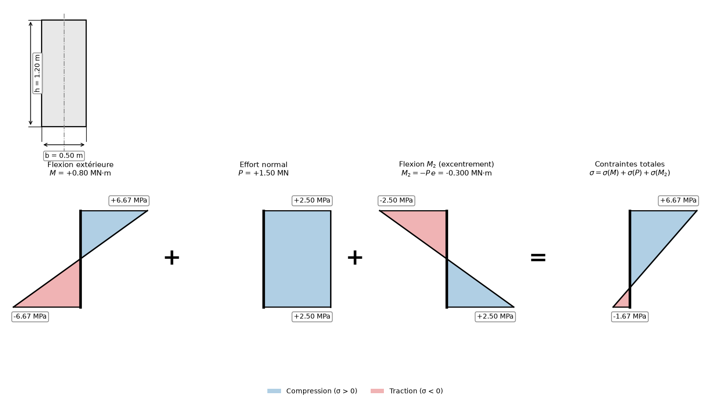

# Diagramme des contraintes — poutre en béton précontraint

Application de bureau Python/PySide6 pour le tracé en temps réel des
contraintes normales d'une section de poutre en béton précontraint, et pour la
détermination de la précontrainte qui ramène la fibre inférieure à la
compression.



## Aperçu

L'outil	superpose les quatre diagrammes de la précontrainte — flexion
extérieure `M`, effort normal `P`, flexion d'excentrement `M₂` et contraintes
totales — dans une seule figure, avec la section cotée. Chaque réglage
redessine l'ensemble, et l'interface rappelle en permanence la valeur de `P` ou
de `e` qui annule la traction en fibre inférieure.

## Fonctionnalités

- **Superposition complète** — `σ = σ_M + σ_P + σ_M₂`, tracée dans les deux sens de la compression et de la traction, avec les valeurs chiffrées aux deux fibres
- **Seuil de traction nulle** — la force `P` ou l'excentrement `e` qui ramène `σ_inf` à zéro, exprimé dans la grandeur que l'on n'est pas en train de régler
- **Moment d'excentreement calculé** — `M₂ = -P·e`, non saisi, déduit de `P` et `e`
- **Contraintes quasi nulles** — bascule automatique sur le seuil d'incompressibilité totale, où seule la précontrainte compte
- **Cœur de calcul sans dépendance** — aucune bibliothèque tierce : les formules sont vérifiables et testables sans Qt ni matplotlib
- **Excentrement borné** — la plage de `e` suit `h` et vaut toujours `e ≤ h/2`, arrondie au pas de 0.005 m
- **Règles d'affichage stables** — hauteur de poutre dessinée constante et aucune échelle de contrainte partagée : les diagrammes restent lisibles pendant la manipulation
- **Section cotée native** — dessinée par `QtCharts`, centrée et à proportions, avec cotes de `b` et `h`, axe de gravité et traits d'attache
- **Export d'image** — la section et les quatre diagrammes réunis dans un seul fichier PNG ou JPEG
- **Batterie de tests** — 66 tests du domaine, du rendu et de l'interface

## Prérequis

| Dépendance | Version minimale | Rôle |
| --- | --- | --- |
| Python | 3.11 | Obligatoire |
| PySide6 | 6.5 | Interface graphique — requis pour `main` |
| matplotlib | 3.7 | Diagrammes de contraintes — requis |
| numpy | 1.24 | Calcul vectoriel des contraintes |
| pytest | 7.4 | Tests — facultatif (`[dev]`) |
| ruff | 0.5 | Analyse statique — facultatif (`[dev]`) |

## Installation

```bash
# Cloner le dépôt
git clone https://github.com/vlax-rsr/Diagramme-contraintes-beton-precontraint-app.git
cd Diagramme-contraintes-beton-precontraint-app

# Créer un environnement virtuel (recommandé)
python -m venv .venv
source .venv/bin/activate        # Windows : .venv\Scripts\activate

# Installer le projet et ses outils de développement
pip install -e ".[dev]"

# Lancer l'application
beton-precontraint                # ou : python -m beton_precontraint
```

Le cœur de calcul n'a aucune dépendance : `src/beton_precontraint/domaine/`
s'importe et se teste avec la seule bibliothèque standard.

## Utilisation

Renseigner les cinq grandeurs de la section :

- **Section et moment extérieur** — largeur `b`, hauteur `h`, moment `M` ; saisie directe au clavier
- **Précontrainte** — force `P` et excentrement `e` ; curseur et saisie, les deux réglages les plus utiles en cours de manipulation

Les quatre diagrammes se redessinent à chaque changement. Le panneau de
résultats indique la contrainte en fibre supérieure et en fibre inférieure,
leur qualité mécanique, et le seuil de traction nulle :

```
σ_inf = -6·M/(b·h²) + P/(b·h) + 6·P·e/(b·h²) = 0   ⟺   P = 6·M/(h + 6·e)
```

Après un changement de `P`, l'interface affiche l'excentrement correspondant ;
après un changement de `e`, la force de précontrainte. Le libellé d'état passe
au bleu si toute la section est comprimée, au rouge dès qu'une fibre est en
traction.

**Enregistrer l'image…** écrit la section cotée et les quatre diagrammes dans un
seul fichier.

## Structure du projet

```
Diagramme-contraintes-beton-precontraint-app/
├── pyproject.toml               # Dépendances, ruff, pytest, script beton-precontraint
├── src/beton_precontraint/      # Paquet : python -m beton_precontraint
│   ├── __main__.py              # Lancement par module
│   ├── application.py           # Point d'entrée : application Qt puis fenêtre
│   ├── theme.py                 # Palette commune : bleu = compression, rouge = traction
│   ├── domaine/                 # Cœur de calcul pur — aucun import graphique
│   │   ├── section.py           # S, I, σ_M, σ_P
│   │   ├── charges.py           # M₂ = -P·e, superposition, diagnostic
│   │   ├── diagramme.py         # Les deux contraintes extrêmes d'un diagramme
│   │   └── relations.py         # P = 6·M/(h + 6·e) et son inverse
│   ├── rendu/                   # matplotlib
│   │   ├── constantes.py        # Hauteur affichée, marges, répartition des colonnes
│   │   ├── diagrammes.py        # tracer_contrainte, VueDiagrammes (temps réel)
│   │   ├── section.py           # tracer_section, pour l'export
│   │   └── figure.py            # figure_complete : section + diagrammes
│   └── presentation/            # PySide6
│       ├── constantes.py        # Valeurs initiales, plages, dimensions
│       ├── reglages.py          # Reglage : champ et curseur synchronisés
│       ├── libelles.py          # Textes affichés, en fonctions pures
│       ├── vue_contraintes.py   # Canevas matplotlib des diagrammes + export
│       ├── vue_section.py       # Section QtCharts
│       └── fenetre.py           # Mise en page et orchestration
├── tests/                       # 66 tests : domaine, rendu, présentation
├── docs/                        # Aperçu de l'interface
├── .github/workflows/           # ruff + pytest sur Windows et Ubuntu
└── LICENSE
```

Les couches ne dépendent que dans un sens : présentation et rendu s'appuient
sur le domaine, jamais l'inverse. Le domaine se teste donc sans environnement
graphique, et le rendu sans PySide6.

Les tests s'exécutent sans écran, en local comme en intégration continue :

```bash
pytest
ruff check .
```

## Formule

```
σ(y) = σ_M(y) + σ_P + σ_M₂(y) = (M - P·e)·y/I + P/(b·h)
```

| Symbole | Définition | Unité |
| --- | --- | --- |
| `b`, `h` | largeur et hauteur de la section | m |
| `I` | inertie, `b·h³/12` | m⁴ |
| `M` | moment fléchissant extérieur, flèche vers le bas | MN·m |
| `P` | force de précontrainte comprimant la section | MN |
| `e` | excentrement du câblage sous le centre de gravité | m |
| `M₂` | moment d'excentrement, `-P·e` | MN·m |
| `y` | ordonnée mesurée vers le haut depuis le centre de gravité | m |
| `σ` | contrainte normale, **compression positive** | MPa |

`M₂ ≤ 0` : il s'oppose toujours à `M > 0`. Les deux flexions se retranchent, et
`M - P·e` est le moment qui donne la pente de la contrainte totale.

Avec `M = 0.80`, `P = 1.50`, `e = 0.20` (soit `h/6`), `b = 0.50 m`,
`h = 1.20 m` :

| | fibre supérieure | fibre inférieure |
| --- | --- | --- |
| σ(M) | +6.67 | −6.67 |
| σ(P) | +2.50 | +2.50 |
| σ(M₂) | −2.50 | +2.50 |
| **σ totale** | **+6.67** | **−1.67** |

## Licence

Distribué sous licence MIT. Voir le fichier LICENSE pour plus de détails.

## Auteur

**Riana STELLIA**

Diagramme des contraintes d'une poutre en béton précontraint, développé dans le
cadre d'un portfolio de calcul de béton précontraint. Contributions et retours
bienvenus via les Issues GitHub.

Les résultats doivent être vérifiés par un bureau d'études avant tout
dimensionnement.